<div align="center">


# AURORA BUSINESS OS

**Your Business. Our Technology. Infinite Possibilities.**

[](https://aurora-business-os.vercel.app/)
[](https://nextjs.org/)
[](https://react.dev/)
[](https://www.typescriptlang.org/)
[](https://tailwindcss.com/)
[](https://supabase.com/)
[](./LICENSE)

[Live Deployment](https://aurora-business-os.vercel.app/) · [Architecture](./docs/ARCHITECTURE.md) · [Database ERD](./docs/DATABASE_ERD.md) · [Setup & Deployment](./docs/SETUP_AND_DEPLOYMENT.md)

</div>

---

## Overview

**AURORA BUSINESS OS** is a multi-tenant, glassmorphism-powered Enterprise Resource Planning (ERP) and Business Intelligence platform built with **Next.js 15 (App Router)**, **TypeScript**, and **Supabase**.

Designed with deep domain specialization for **cross-border Luxury Perfume & Fragrance operations (Saudi Arabia → Bangladesh)** while remaining fully extensible across arbitrary business categories through a dynamic attribute-schema engine.

> **Live UI Preview:** Deployed on Vercel at **[aurora-business-os.vercel.app](https://aurora-business-os.vercel.app/)**. Without Supabase credentials configured, the app safely boots into **Demo Mode** (`Aurora Scents BD (Demo)`) so the glassmorphism UI, 3-theme engine, and executive dashboard can be explored immediately. Connecting Supabase activates full multi-organization authentication, Row-Level Security (RLS), and live CRUD modules.

---

## 5-Phase Architecture & Implemented Modules

| Phase | Module Focus | Key Capabilities |
| :--- | :--- | :--- |
| **PART 01** | **Foundation & Futuristic UI** | Glassmorphism design system, 3 selectable themes (Midnight Blue, Emerald Aurora, Light Glass), collapsible `GlassSidebar`, `TopGlassNavbar` with `Ctrl K` search & notifications, responsive Executive Dashboard (`12` KPIs, Recharts analytics, `8` period filters, compact/expanded view, widget customization). |
| **PART 02** | **Database, Auth & Multi-Tenancy** | Supabase Auth (`/auth/login`, `/auth/register`, `/auth/forgot-password`, `/auth/reset-password`, `/onboarding`, `/profile`), strict organization isolation via PostgreSQL RLS, 7-role RBAC engine, dynamic category attribute builder, and organization storage buckets. |
| **PART 03** | **Core Business Operations** | Full CRUD for **Products** (with dynamic perfume notes, concentration, volume, batch & authenticity status), **Categories & Brands**, **Inventory** (stock in/out/adjust/transfer, warehouses, batch tracking, CSV/Excel export), **Suppliers** (comparison, brand mapping, rating, price/purchase history), **Customers CRM** (VIP/Wholesale segmentation, CLV), **Sales & Daily Register**, **Orders & Invoices**, and **Purchase Orders**. |
| **PART 04** | **Finance, Import & Logistics** | Consistent **Financial Engine** (Revenue, COGS, Gross/Net Profit, Break-even), **P&L & Cash Flow Statements** (PDF/Excel export), **Expenses**, **KSA → Bangladesh Import Cost Calculator** (`SAR` → `BDT`, customs duty, VAT/tax estimation, cost allocation), **Shipping & Logistics Calculator** (air/sea/courier, volumetric vs. chargeable weight, dangerous-goods review indicator), and **Marketing & Ads ROI**. |
| **PART 05** | **AI Intelligence & Production Ops** | **Advanced Analytics & MoM Dashboard**, **Stock Alert Engine** (low/out/overstock, fast/slow movers, reorder suggestions), **Best-Selling Perfume Intelligence**, **AI Business Assistant** (strictly separates recorded facts, calculated metrics, forecasts, recommendations & missing data; human-approval proposals; optional Gemini/OpenAI synthesis), **Reports Center** (`12` report types in PDF/CSV/Excel), **Audit Logs**, and **JSON Backup Export**. |

---

## Cross-Border Perfume Trade & System Flow

```mermaid
flowchart LR
    A["Luxury Brands & Suppliers<br/>(Saudi Arabia / Global)"] --> B["Purchase Orders &<br/>Batch Receiving"]
    B --> C["KSA → BD Import &<br/>Customs Estimator (SAR/BDT)"]
    C --> D["Shipping & Dangerous-Goods<br/>Weight Calculator"]
    D --> E["Multi-Warehouse Inventory<br/>& Batch Ledger"]
    E --> F["POS / Sales Register<br/>Orders & Invoices"]
    F --> G["Financial Engine<br/>P&L · Cash Flow · Marketing ROI"]
    G --> H["AI Business Assistant<br/>& Reports Center (PDF/XLSX)"]
```



---

## Application Routes & API Surface

<details>
<summary><strong>Explore App Modules (<code>src/app/(modules)/*</code>) & API Routes (<code>src/app/api/*</code>)</strong></summary>

### UI Modules
- `/` — Executive Dashboard (`Aurora Scents BD` demo fallback when unconfigured)
- `/products` · `/categories-brands` · `/inventory`
- `/suppliers` · `/customers` · `/purchases`
- `/sales` · `/orders`
- `/finance` · `/expenses` · `/import-management` · `/shipping-logistics` · `/marketing-ads`
- `/analytics` · `/ai-assistant` · `/reports`
- `/onboarding` · `/profile` · `/auth/login` · `/auth/register` · `/auth/forgot-password` · `/auth/reset-password`

### Backend API Endpoints (`26` route groups)
- **Core & Security:** `organizations`, `members`, `settings`, `preferences`, `storage`, `activity-logs`, `backup`
- **Operations:** `categories`, `brands`, `products`, `inventory`, `suppliers`, `customers`, `sales`, `invoices`, `purchase-orders`
- **Finance & Logistics:** `finance`, `expenses`, `imports`, `shipments`, `marketing`
- **Intelligence & Workspace:** `analytics`, `ai-assistant`, `reports`, `search`, `notifications`

</details>

---

## Tech Stack

| Layer | Technology |
| :--- | :--- |
| **Framework** | Next.js `15.3` (App Router), React `19.1`, TypeScript `5.8` |
| **Styling & Motion** | Tailwind CSS `4.1`, custom CSS glassmorphism tokens, Framer Motion `12.6`, Lucide Icons |
| **Data, Tables & Charts** | TanStack Table `8.21`, Recharts `2.15`, React Hook Form `7.56`, Zod `3.24` |
| **Backend & Security** | Supabase (`@supabase/ssr`, `@supabase/supabase-js`), PostgreSQL Row-Level Security (RLS) |
| **Exports & Tooling** | `jspdf` + `jspdf-autotable` (PDF), `xlsx` (Excel/CSV), Vitest `5.1`, ESLint `9` |

---

## Database Migrations

Apply the ordered SQL migrations in `supabase/migrations/` (via Supabase SQL Editor or CLI) to provision the full schema, RLS policies, storage buckets, and transactional functions:

1. `202611250001_core_schema.sql` — Organizations, profiles, RBAC roles, dynamic business categories
2. `202611250002_rls_and_functions.sql` — Organization isolation policies & helper functions
3. `202611250003_storage_buckets.sql` — Private/org-scoped media & document storage rules
4. `202611250004_seed_roles_and_categories.sql` — Default roles & perfume attribute schemas
5. `202611250005_part3_operations.sql` — Products, brands, warehouses, suppliers, customers, sales, POs
6. `202611250006_part3_transactions.sql` — Transactional stock movement & invoice procedures
7. `202611250007_part4_finance_import_marketing.sql` — Ledger accounts, expenses, imports, shipments, campaigns
8. `202611250008_part5_intelligence_alerts_backups.sql` — Stock alerts, AI briefs/proposals, audit & backup tables

---

## Quick Start (Local Development)

### 1. Clone & Install
```bash
git clone https://github.com/gitwithmasum/AURORA-BUSINESS-OS.git
cd AURORA-BUSINESS-OS
npm install
```

### 2. Configure Environment
Copy `.env.example` to `.env.local` and provide your Supabase project keys (for full auth & database mode):
```env
NEXT_PUBLIC_SUPABASE_URL=https://your-project-ref.supabase.co
NEXT_PUBLIC_SUPABASE_ANON_KEY=your-supabase-anon-key
SUPABASE_SERVICE_ROLE_KEY=your-supabase-service-role-key
NEXT_PUBLIC_APP_URL=http://localhost:3000

# Optional server-only keys for AI narrative synthesis in /ai-assistant
GEMINI_API_KEY=
OPENAI_API_KEY=
```

### 3. Run & Verify
```bash
npm run dev       # Start Next.js development server
npm test          # Run Vitest suite (tests/part2–part5.test.ts)
npm run typecheck # Run TypeScript strict check (tsc --noEmit)
npm run lint      # Run Next.js ESLint checks
npm run build     # Production build verification
```

---

## Documentation & License

- **[Architecture Overview](./docs/ARCHITECTURE.md)** — UI shell, token architecture, and multi-tenant boundaries
- **[Database ERD](./docs/DATABASE_ERD.md)** — Relational structure across all business domains
- **[Setup & Deployment Guide](./docs/SETUP_AND_DEPLOYMENT.md)** — Supabase Auth redirects, RLS verification, and Vercel setup

Licensed under the **[MIT License](./LICENSE)** © 2026 Masum Billah.

---

<div align="center">

**Build. Manage. Grow.** · *AURORA BUSINESS OS*

</div>
