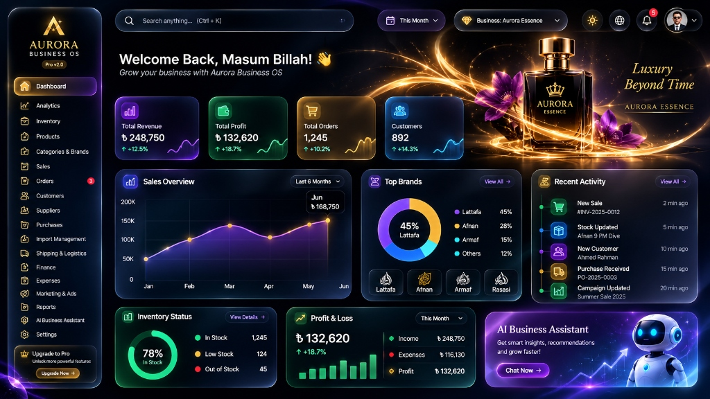

<div align="center">

<a href="https://aurora-business-os.vercel.app/">
  
</a>

<br />

# AURORA BUSINESS OS

**Glassmorphism Multi-Tenant ERP · KSA → Bangladesh Import Engine · AI Business Intelligence**

<p>
  <a href="https://aurora-business-os.vercel.app/">
    
  </a>
  <a href="https://supabase.com/">
    
  </a>
  <a href="https://nextjs.org/">
    
  </a>
  <a href="https://react.dev/">
    
  </a>
  <a href="https://www.typescriptlang.org/">
    
  </a>
  <a href="https://tailwindcss.com/">
    
  </a>
  <a href="./LICENSE">
    
  </a>
</p>

<p>
  <a href="https://aurora-business-os.vercel.app/"><strong>Launch Live App</strong></a>
  &nbsp;·&nbsp;
  <a href="https://aurora-business-os.vercel.app/auth/register"><strong>Create Workspace</strong></a>
  &nbsp;·&nbsp;
  <a href="./docs/ARCHITECTURE.md"><strong>System Architecture</strong></a>
  &nbsp;·&nbsp;
  <a href="./docs/DATABASE_ERD.md"><strong>Database ERD</strong></a>
  &nbsp;·&nbsp;
  <a href="./docs/SETUP_AND_DEPLOYMENT.md"><strong>Deployment Guide</strong></a>
</p>

</div>

---

## ⚡ System Identity & Core Capabilities

**AURORA BUSINESS OS** is a production-grade, multi-tenant **Business Operating System** built with **Next.js 15 (App Router)**, **TypeScript**, **Tailwind CSS v4**, and **Supabase PostgreSQL**.

Engineered specifically for **cross-border Luxury Perfume & Fragrance trade (Saudi Arabia → Bangladesh)** while remaining dynamically extensible to any vertical via a schema-driven **Custom Attribute Engine**.

| Pillar | Architecture & Guarantees |
| :--- | :--- |
| 🎨 **Futuristic Glass Shell** | 3 synchronized themes (**Midnight Blue**, **Emerald Aurora**, **Light Glass**), Framer Motion transitions, collapsible `GlassSidebar`, `TopGlassNavbar` with <kbd>Ctrl</kbd>+<kbd>K</kbd> command search, bilingual **EN / BN** labels, and custom golden prism branding (`AURORA BUSINESS OS`). |
| 🔐 **Zero-Trust Multi-Tenancy** | Supabase Auth (`/auth/login`, `/auth/register`, `/auth/callback`), organization-scoped **Row-Level Security (RLS)** verified across 18 core tenant tables, and **7-tier RBAC** (`owner`, `admin`, `manager`, `accountant`, `inventory_manager`, `salesperson`, `viewer`). |
| 🧮 **Strict Accounting Engine** | Separates **Revenue (Accrual)**, **Cash Receipts**, **Inventory Purchases**, **COGS**, **Expenses**, and **Net Profit** across Cash, Bank, and MFS accounts—with PDF & Excel exports. |
| ✈️ **KSA → BD Import & Freight** | Dedicated **SAR → BDT** landed cost calculator, multi-item shipment cost allocation, Bangladesh Customs & VAT estimator, volumetric vs. chargeable weight, and Dangerous Goods review flags. |
| 🤖 **Grounded AI Intelligence** | Strictly separates **Recorded Facts**, **Calculated Metrics**, **Forecasts**, **Recommendations**, and **Missing Data**—never fabricates records or auto-executes mutations without human approval. |

---

## 🧭 6-Domain Command Matrix (`18` Core Modules)

<table>
  <thead>
    <tr>
      <th>Domain</th>
      <th>Module</th>
      <th>Route</th>
      <th>Operational Scope</th>
    </tr>
  </thead>
  <tbody>
    <tr>
      <td rowspan="2"><strong>01 · Command Center</strong></td>
      <td>Executive Overview</td>
      <td><code>/</code></td>
      <td>12 KPI telemetry cards, Recharts revenue/profit trends, 8 period filters, customizable widget grid</td>
    </tr>
    <tr>
      <td>Advanced Analytics</td>
      <td><code>/analytics</code></td>
      <td>MoM comparisons, inventory turnover, stock alerts, &amp; Best-Selling Perfume Intelligence</td>
    </tr>
    <tr>
      <td rowspan="3"><strong>02 · Catalog &amp; Stock</strong></td>
      <td>Inventory</td>
      <td><code>/inventory</code></td>
      <td>Multi-warehouse ledger, batch tracking, movements, valuation, non-negative stock guard, CSV/XLSX</td>
    </tr>
    <tr>
      <td>Products</td>
      <td><code>/products</code></td>
      <td>Full CRUD powered by the Dynamic Category &amp; Perfume Notes/Concentration/Authenticity schema</td>
    </tr>
    <tr>
      <td>Categories &amp; Brands</td>
      <td><code>/categories-brands</code></td>
      <td>Dynamic business category builder, custom attribute definitions, brand registry &amp; logos</td>
    </tr>
    <tr>
      <td rowspan="3"><strong>03 · Sales &amp; CRM</strong></td>
      <td>Sales</td>
      <td><code>/sales</code></td>
      <td>Quick Sale, Daily Sales Register, multi-item checkout, returns, refunds, multi-channel tracking</td>
    </tr>
    <tr>
      <td>Orders &amp; Invoices</td>
      <td><code>/orders</code></td>
      <td>Order lifecycle + branded Sales, Purchase, Proforma &amp; Credit Note PDF/CSV invoice generator</td>
    </tr>
    <tr>
      <td>Customers CRM</td>
      <td><code>/customers</code></td>
      <td>Customer profiles, VIP &amp; Wholesale segmentation, CLV, outstanding balances, follow-up reminders</td>
    </tr>
    <tr>
      <td rowspan="4"><strong>04 · Supply &amp; KSA→BD</strong></td>
      <td>Suppliers</td>
      <td><code>/suppliers</code></td>
      <td>100+ scalable directory, brand mapping, verification status, comparison, price &amp; PO history</td>
    </tr>
    <tr>
      <td>Purchases (PO)</td>
      <td><code>/purchases</code></td>
      <td>Purchase Order creation, approval workflow, partial/full batch receiving, landed cost allocation</td>
    </tr>
    <tr>
      <td>Import Management</td>
      <td><code>/import-management</code></td>
      <td>Saudi Arabia → Bangladesh SAR/BDT import cost calculator, saved scenarios, BD Customs/VAT estimator</td>
    </tr>
    <tr>
      <td>Shipping &amp; Logistics</td>
      <td><code>/shipping-logistics</code></td>
      <td>Air, Sea &amp; Courier rate calculator, volumetric weight engine, Dangerous Goods confirmation flags</td>
    </tr>
    <tr>
      <td rowspan="4"><strong>05 · Finance &amp; Growth</strong></td>
      <td>Finance</td>
      <td><code>/finance</code></td>
      <td>Daily/Weekly/Monthly/Quarterly/Annual/Custom P&amp;L, multi-account Cash Flow, Break-even Simulator</td>
    </tr>
    <tr>
      <td>Expenses</td>
      <td><code>/expenses</code></td>
      <td>Operating, marketing, freight, customs &amp; admin expense ledger with approval workflows</td>
    </tr>
    <tr>
      <td>Marketing &amp; Ads</td>
      <td><code>/marketing-ads</code></td>
      <td>Facebook Ads ROI tracker computing CTR, CPC, CAC, ROAS &amp; net post-ad contribution</td>
    </tr>
    <tr>
      <td>Reports Center</td>
      <td><code>/reports</code></td>
      <td>12 enterprise reports (Inventory, Sales, P&amp;L, Cash Flow, Import, Tax, Supplier) in PDF/CSV/Excel</td>
    </tr>
    <tr>
      <td rowspan="2"><strong>06 · Intelligence &amp; OS</strong></td>
      <td>AI Business Assistant</td>
      <td><code>/ai-assistant</code></td>
      <td>Data-grounded Q&amp;A, demand &amp; cash forecasting, human-approved action proposals, optional Gemini/OpenAI</td>
    </tr>
    <tr>
      <td>Settings &amp; Audit</td>
      <td><code>/settings</code></td>
      <td>Theme engine, organization settings, team RBAC management, immutable activity logs &amp; JSON backups</td>
    </tr>
  </tbody>
</table>

---

## 🔄 End-to-End Business & Telemetry Flow

```mermaid
flowchart LR
    S["🏭 Luxury Suppliers<br/>(Saudi Arabia / Global)"] --> PO["📋 Purchase Orders<br/>& Partial Receiving"]
    PO --> IMP["✈️ KSA → BD Import Cost<br/>(SAR/BDT · Customs · VAT)"]
    IMP --> SHP["🚢 Shipping & Logistics<br/>(Chargeable Weight · DG Flag)"]
    SHP --> INV["📦 Multi-Warehouse Ledger<br/>(Batch · Non-Negative Guard)"]
    INV --> POS["🛍️ Sales Register & Orders<br/>(Invoices · Returns · CRM)"]
    POS --> FIN["💎 Financial Engine<br/>(P&L · Cash Flow · Ads ROAS)"]
    FIN --> AI["🤖 AI Business Assistant<br/>& 12 Exportable Reports"]
```



---

## 🚀 5-Phase Engineering Blueprint

| Phase | Milestone | Core Deliverables |
| :---: | :--- | :--- |
| **PART 01** | **Foundation & Glass UI** | Tokenized 3-theme design system (`src/styles/tokens.css`), 16 glass primitives, `GlassSidebar`, `TopGlassNavbar`, responsive Executive Dashboard |
| **PART 02** | **Auth, RLS & Config** | Supabase Auth & SSR middleware, multi-organization onboarding, 7-role RBAC matrix, org-scoped storage, Dynamic Category Schema Engine |
| **PART 03** | **Core ERP Operations** | Products, Categories & Brands, Transactional Inventory Ledger, 100+ Suppliers, Customer CRM, Sales Register, Invoice Generator, Purchase Orders |
| **PART 04** | **Finance, Import & Ads** | Financial Calculation Engine, P&L & Cash Flow Statements, KSA→BD Import Calculator, Bangladesh Tax/VAT Estimator, Shipping & Facebook Ads ROI |
| **PART 05** | **AI, Analytics & Ops** | Unified Analytics & MoM Dashboard, Reorder Stock Alerts, Perfume Intelligence, Grounded AI Assistant, Reports Center, Search, Audit Logs & Backups |

---

## 🗄️ Database & API Architecture

<details>
<summary><strong>PostgreSQL Migrations (<code>supabase/migrations/</code>) &amp; RLS Verification</strong></summary>

1. `202611250001_core_schema.sql` — Profiles, organizations, workspaces, RBAC roles, dynamic business categories & attributes
2. `202611250002_rls_and_functions.sql` — Multi-tenant Row-Level Security policies & helper security functions
3. `202611250003_storage_buckets.sql` — Organization-isolated storage buckets for product, brand & document uploads
4. `202611250004_seed_roles_and_categories.sql` — 7 system RBAC roles & default Perfume attribute definitions
5. `202611250005_part3_operations.sql` — Brands, products, warehouses, inventory, suppliers, customers, sales & purchase orders
6. `202611250006_part3_transactions.sql` — Atomic stock movements, non-negative stock enforcement & invoicing functions
7. `202611250007_part4_finance_import_marketing.sql` — Financial accounts, expenses, import scenarios, shipments & ad campaigns
8. `202611250008_part5_intelligence_alerts_backups.sql` — Stock alert rules, AI briefs/action proposals, activity logs & backup exports

Run `supabase/tests/rls_isolation_check.sql` inside the Supabase SQL Editor to verify RLS on all 18 core tenant tables and confirm all 7 RBAC roles are active.

</details>

<details>
<summary><strong>API Route Surface (<code>26</code> Route Groups under <code>src/app/api/*</code>)</strong></summary>

- **Auth, Org & Governance:** `organizations`, `members`, `settings`, `preferences`, `storage/upload`, `activity-logs`, `backup`
- **Catalog, Stock & Supply:** `categories`, `brands`, `products`, `inventory`, `suppliers`, `purchase-orders`
- **Commerce & CRM:** `customers`, `sales`, `invoices`
- **Finance, Import & Marketing:** `finance`, `expenses`, `imports`, `shipments`, `marketing`
- **Intelligence & Shell:** `analytics`, `ai-assistant`, `reports`, `search`, `notifications`

</details>

---

## ⚙️ Tech Stack

| Layer | Technologies |
| :--- | :--- |
| **Core Framework** | Next.js `15.3` (App Router) · React `19.1` · TypeScript `5.8` |
| **UI & Visualization** | Tailwind CSS `4.1` · Framer Motion `12.6` · Recharts `2.15` · TanStack Table `8.21` · Lucide Icons |
| **Forms & Validation** | React Hook Form `7.56` · Zod `3.24` · `@hookform/resolvers` |
| **Database & Auth** | Supabase (`@supabase/ssr`, `@supabase/supabase-js`) · PostgreSQL RLS |
| **Exports & QA** | `jspdf` + `jspdf-autotable` (PDF) · `xlsx` (Excel/CSV) · Vitest `5.1` (`32` unit & contract tests) · ESLint `9` |

---

## 🛠️ Local Setup & Verification

```bash
# 1. Clone repository
git clone https://github.com/gitwithmasum/AURORA-BUSINESS-OS.git
cd AURORA-BUSINESS-OS

# 2. Install dependencies
npm install

# 3. Configure environment
cp .env.example .env.local
```

Configure `.env.local` (never expose `SUPABASE_SERVICE_ROLE_KEY`, `GEMINI_API_KEY`, or `OPENAI_API_KEY` to client code):

```env
NEXT_PUBLIC_SUPABASE_URL=https://your-project-ref.supabase.co
NEXT_PUBLIC_SUPABASE_ANON_KEY=your-supabase-anon-key
SUPABASE_SERVICE_ROLE_KEY=your-supabase-service-role-key
NEXT_PUBLIC_APP_URL=http://localhost:3000

# Optional server-only keys for LLM synthesis in /ai-assistant
GEMINI_API_KEY=
OPENAI_API_KEY=
```

```bash
# 4. Run development server & quality suite
npm run dev       # Start local dev server
npm test          # Run Vitest suite (tests/part2–part5.test.ts)
npm run typecheck # Run TypeScript strict compiler check
npm run lint      # Run ESLint verification
npm run build     # Build production bundle
```

---

<div align="center">

**[AURORA BUSINESS OS](https://aurora-business-os.vercel.app/)** · Built by **Masum Billah** · Licensed under the **[MIT License](./LICENSE)**

*Build. Manage. Grow.*

</div>
