# AURORA BUSINESS OS — Database Entity Relationship Plan (PostgreSQL / Supabase)

> **Phase 1 Deliverable** — Normalized Multi-Tenant Schema & Isolation Design  
> **Target Engine**: PostgreSQL 15+ (Supabase) with Row Level Security (RLS)

---

## 1. Multi-Tenancy & Isolation Strategy

- Every business-owned table includes `organization_id UUID NOT NULL REFERENCES organizations(id) ON DELETE CASCADE`.
- Operational records linked to branches/storefronts also carry `workspace_id UUID REFERENCES workspaces(id)`.
- Helper SQL function `auth.current_org_ids()` resolves the authenticated user's active memberships in `organization_members` so every RLS policy enforces zero cross-organization data leakage.
- All monetary columns use `NUMERIC(14, 2)` (or `NUMERIC(14, 4)` for unit costs & FX rates) — never floating-point `FLOAT`.

---

## 2. Core Entity Relationship Diagram (Mermaid)

```mermaid
erDiagram
    organizations ||--o{ workspaces : owns
    organizations ||--o{ organization_members : has
    users ||--o{ organization_members : joins
    organizations ||--|| business_settings : configures
    organizations ||--o{ business_categories : defines
    business_categories ||--o{ custom_product_attributes : defines

    organizations ||--o{ brands : owns
    organizations ||--o{ products : catalogs
    business_categories ||--o{ products : classifies
    brands ||--o{ products : labels
    products ||--o{ product_attribute_values : stores
    custom_product_attributes ||--o{ product_attribute_values : types

    organizations ||--o{ warehouses : operates
    products ||--o{ inventory : stocked_in
    warehouses ||--o{ inventory : holds
    products ||--o{ inventory_movements : tracks
    warehouses ||--o{ inventory_movements : logs

    organizations ||--o{ suppliers : sources_from
    suppliers ||--o{ supplier_brands : supplies
    brands ||--o{ supplier_brands : mapped_to
    suppliers ||--o{ supplier_price_history : quotes
    products ||--o{ supplier_price_history : priced_at

    organizations ||--o{ customers : serves
    customers ||--o{ customer_addresses : has

    organizations ||--o{ sales : records
    customers ||--o{ sales : places
    sales ||--o{ sale_items : contains
    products ||--o{ sale_items : sold_in
    sales ||--o{ sales_returns : reversed_by

    organizations ||--o{ purchase_orders : issues
    suppliers ||--o{ purchase_orders : fulfills
    purchase_orders ||--o{ purchase_order_items : specifies
    purchase_orders ||--o{ purchases : received_as
    purchases ||--o{ purchase_items : contains

    organizations ||--o{ import_scenarios : simulates
    import_scenarios ||--o{ import_cost_items : breaks_down
    organizations ||--o{ shipments : tracks
    organizations ||--o{ tax_configurations : applies

    organizations ||--o{ financial_accounts : holds
    organizations ||--o{ financial_transactions : records
    financial_accounts ||--o{ financial_transactions : settles
    organizations ||--o{ expenses : incurs
    organizations ||--o{ invoices : issues
    invoices ||--o{ invoice_items : lists

    organizations ||--o{ marketing_campaigns : runs
    marketing_campaigns ||--o{ marketing_metrics : measures
    organizations ||--o{ notifications : alerts
    organizations ||--o{ activity_logs : audits
    users ||--o{ user_preferences : personalizes
```

---

## 3. Domain Table Specifications

### A. Tenancy, Auth & Configuration
| Table | Key Columns | Purpose & Constraints |
| :--- | :--- | :--- |
| `organizations` | `id (PK)`, `name`, `slug (UNIQUE)`, `status`, `created_at` | Root tenant boundary |
| `workspaces` | `id (PK)`, `organization_id (FK)`, `name`, `code`, `is_default` | Branch / storefront / warehouse division |
| `users` | `id (PK, auth.users)`, `email (UNIQUE)`, `full_name`, `avatar_url` | Profile mirror of Supabase Auth user |
| `organization_members` | `id (PK)`, `organization_id (FK)`, `user_id (FK)`, `role`, `permissions (JSONB)` | Unique `(organization_id, user_id)`; 7 RBAC roles |
| `business_settings` | `id (PK)`, `organization_id (FK, UNIQUE)`, `business_name`, `logo_url`, `primary_category_id`, `country`, `currency`, `tax_config (JSONB)`, `sales_channels (JSONB)`, `inventory_model`, `financial_year_start`, `timezone`, `allow_negative_stock (BOOL DEFAULT false)` | Universal onboarding configuration |
| `user_preferences` | `id (PK)`, `user_id (FK)`, `organization_id (FK)`, `theme`, `language`, `sidebar_collapsed`, `dashboard_layout (JSONB)` | Persisted UI & widget layout per user |

### B. Universal Product & Dynamic Category Engine
| Table | Key Columns | Purpose & Constraints |
| :--- | :--- | :--- |
| `business_categories` | `id (PK)`, `organization_id (FK)`, `name`, `slug`, `is_system`, `icon` | Configurable industries (Perfume, Electronics, Fashion, etc.) |
| `custom_product_attributes` | `id (PK)`, `organization_id (FK)`, `category_id (FK)`, `key`, `label`, `data_type`, `options (JSONB)`, `is_required`, `sort_order` | Dynamic schema (e.g., `volume_ml`, `concentration`, `fragrance_family`, `warranty_months`) |
| `brands` | `id (PK)`, `organization_id (FK)`, `name`, `country_of_origin`, `is_demo` | Brand registry (e.g., Lattafa, Dior, Rasasi) |
| `products` | `id (PK)`, `organization_id (FK)`, `category_id (FK)`, `brand_id (FK)`, `sku`, `barcode`, `name`, `unit`, `purchase_cost`, `selling_price`, `min_stock`, `status`, `is_demo` | Unique `(organization_id, sku)` |
| `product_attribute_values` | `id (PK)`, `product_id (FK)`, `attribute_id (FK)`, `value_text`, `value_number`, `value_json` | Unique `(product_id, attribute_id)` |

### C. Inventory, Warehouses & Traceable Movements
| Table | Key Columns | Purpose & Constraints |
| :--- | :--- | :--- |
| `warehouses` | `id (PK)`, `organization_id (FK)`, `workspace_id (FK)`, `name`, `code`, `address`, `is_default` | Physical or virtual stock locations |
| `inventory` | `id (PK)`, `organization_id (FK)`, `product_id (FK)`, `warehouse_id (FK)`, `batch_number`, `expiry_date`, `quantity_on_hand`, `reserved_quantity`, `unit_landed_cost` | `CHECK (quantity_on_hand >= 0)` unless authorized override |
| `inventory_movements` | `id (PK)`, `organization_id (FK)`, `product_id (FK)`, `warehouse_id (FK)`, `movement_type`, `quantity_delta`, `unit_cost`, `reference_type`, `reference_id`, `actor_user_id`, `notes`, `created_at` | Immutable ledger (`stock_in`, `stock_out`, `sale`, `return`, `transfer`, `adjustment`) |

### D. Suppliers & Procurement
| Table | Key Columns | Purpose & Constraints |
| :--- | :--- | :--- |
| `suppliers` | `id (PK)`, `organization_id (FK)`, `supplier_code`, `name`, `country`, `city`, `contact_person`, `phone`, `whatsapp`, `email`, `website`, `reg_reference`, `moq`, `currency`, `lead_time_days`, `payment_terms`, `export_capable`, `verification_status`, `partnership_status`, `rating`, `is_demo` | Indexed on `(organization_id, country, partnership_status)` for 100+ supplier scale |
| `supplier_brands` | `id (PK)`, `organization_id (FK)`, `supplier_id (FK)`, `brand_id (FK)` | Brand-to-supplier sourcing map |
| `supplier_price_history` | `id (PK)`, `organization_id (FK)`, `supplier_id (FK)`, `product_id (FK)`, `currency`, `wholesale_price`, `quoted_at`, `source_reference` | Historical supplier pricing audit |
| `purchase_orders` | `id (PK)`, `organization_id (FK)`, `supplier_id (FK)`, `po_number`, `status`, `order_date`, `expected_delivery`, `currency`, `exchange_rate`, `shipping_cost`, `additional_costs`, `total_amount`, `approved_by`, `approved_at` | `draft` -> `in_review` -> `approved` -> `ordered` -> `partial_received` / `received` / `cancelled` |
| `purchase_order_items` | `id (PK)`, `po_id (FK)`, `product_id (FK)`, `quantity_ordered`, `quantity_received`, `unit_price` | Enables partial receiving tracking |
| `purchases` | `id (PK)`, `organization_id (FK)`, `po_id (FK, NULLABLE)`, `supplier_id (FK)`, `warehouse_id (FK)`, `received_date`, `total_cost`, `status` | Actual stock receipt event |
| `purchase_items` | `id (PK)`, `purchase_id (FK)`, `product_id (FK)`, `batch_number`, `quantity`, `unit_cost`, `allocated_landed_cost` | Links landed cost to batch inventory |

### E. CRM, Sales, Returns & Invoicing
| Table | Key Columns | Purpose & Constraints |
| :--- | :--- | :--- |
| `customers` | `id (PK)`, `organization_id (FK)`, `customer_code`, `full_name`, `phone`, `email`, `city`, `segment`, `loyalty_points`, `notes`, `is_demo` | Segments: `new`, `regular`, `vip`, `inactive`, `wholesale` |
| `customer_addresses` | `id (PK)`, `organization_id (FK)`, `customer_id (FK)`, `label`, `address_line`, `city`, `country`, `is_default` | Delivery & billing addresses |
| `sales` | `id (PK)`, `organization_id (FK)`, `workspace_id (FK)`, `customer_id (FK)`, `invoice_number`, `sale_date`, `channel`, `payment_method`, `payment_status`, `order_status`, `subtotal`, `discount_total`, `tax_total`, `grand_total`, `cogs_total`, `salesperson_id` | Cancelled orders excluded from completed revenue |
| `sale_items` | `id (PK)`, `sale_id (FK)`, `product_id (FK)`, `warehouse_id (FK)`, `quantity`, `unit_price`, `unit_cost_at_sale`, `discount`, `tax_amount`, `line_total` | Snapshots COGS at time of sale |
| `sales_returns` | `id (PK)`, `organization_id (FK)`, `sale_id (FK)`, `return_date`, `reason`, `refund_amount`, `restock_warehouse_id`, `status` | Creates reverse stock movement & credit adjustment |
| `invoices` | `id (PK)`, `organization_id (FK)`, `invoice_type`, `invoice_number`, `sale_id (FK, NULLABLE)`, `purchase_id (FK, NULLABLE)`, `issue_date`, `due_date`, `status`, `template_key`, `total_amount` | Supports `sales`, `purchase`, `proforma`, `credit_note` |
| `invoice_items` | `id (PK)`, `invoice_id (FK)`, `description`, `sku`, `quantity`, `unit_price`, `discount`, `tax`, `line_total` | Printable/PDF line snapshot |

### F. KSA → BD Import, Logistics & Configurable Tax Engine
| Table | Key Columns | Purpose & Constraints |
| :--- | :--- | :--- |
| `tax_configurations` | `id (PK)`, `organization_id (FK)`, `country_code`, `name`, `hs_code`, `effective_date`, `customs_duty_pct`, `regulatory_duty_pct`, `supplementary_duty_pct`, `vat_pct`, `advance_tax_pct`, `other_taxes (JSONB)`, `assumptions_note`, `verified_by_user` | Dated, user-configured estimation rules |
| `import_scenarios` | `id (PK)`, `organization_id (FK)`, `title`, `origin_country`, `destination_country`, `fx_currency`, `exchange_rate`, `tax_config_id (FK)`, `total_landed_cost_bdt`, `is_estimate (BOOL DEFAULT true)` | Saved per-product or bulk import simulations |
| `import_cost_items` | `id (PK)`, `scenario_id (FK)`, `product_id (FK, NULLABLE)`, `cost_category`, `description`, `amount_foreign`, `amount_bdt` | Supplier fees, freight, insurance, C&F, customs, local transport |
| `shipments` | `id (PK)`, `organization_id (FK)`, `po_id (FK, NULLABLE)`, `origin_country`, `destination_country`, `method`, `carrier_name`, `gross_weight_kg`, `volumetric_weight_kg`, `chargeable_weight_kg`, `dg_review_status`, `dg_verified_notes`, `freight_cost`, `status` | Air/Sea/Courier + Dangerous Goods verification flag |

### G. Accounting, Cash Flow, Marketing & Governance
| Table | Key Columns | Purpose & Constraints |
| :--- | :--- | :--- |
| `financial_accounts` | `id (PK)`, `organization_id (FK)`, `account_name`, `account_type`, `institution`, `currency`, `opening_balance`, `is_active` | Cash, Bank, MFS (bKash/Nagad/etc.) |
| `financial_transactions` | `id (PK)`, `organization_id (FK)`, `account_id (FK)`, `direction`, `category`, `amount`, `tx_date`, `reference_type`, `reference_id`, `description` | Source of truth for Cash Flow Statement |
| `expenses` | `id (PK)`, `organization_id (FK)`, `expense_category`, `vendor_name`, `expense_date`, `amount`, `payment_status`, `account_id (FK, NULLABLE)`, `notes` | Operating, Marketing, Shipping, Import, Other |
| `marketing_campaigns` | `id (PK)`, `organization_id (FK)`, `name`, `platform`, `objective`, `start_date`, `end_date`, `budget`, `status` | Facebook Ads & cross-channel campaign metadata |
| `marketing_metrics` | `id (PK)`, `organization_id (FK)`, `campaign_id (FK)`, `metric_date`, `spend`, `impressions`, `reach`, `clicks`, `leads`, `orders`, `attributed_revenue`, `product_cost`, `variable_cost` | Computes CTR, CPC, CPM, CAC, ROAS, Contribution After Ads |
| `notifications` | `id (PK)`, `organization_id (FK)`, `user_id (FK, NULLABLE)`, `type`, `severity`, `title`, `message`, `is_read`, `action_url`, `created_at` | Stock alerts, PO approvals, overdue invoices |
| `activity_logs` | `id (PK)`, `organization_id (FK)`, `actor_user_id (FK)`, `action`, `entity_type`, `entity_id`, `metadata (JSONB)`, `created_at` | Immutable audit trail |

---

## 4. Essential Indexes & Transactional RPCs (Phase 3 Plan)

- **Composite Indexes**: `(organization_id, created_at DESC)` on `sales`, `inventory_movements`, `financial_transactions`, `activity_logs`; `(organization_id, sku)` on `products`; `(organization_id, name)` trigram index on `suppliers` and `customers` for fast search at 1,000+ rows.
- **Database RPCs**:
  1. `complete_sale_txn(...)`: Validates stock (blocks negative inventory unless `allow_negative_stock` override is true & authorized), inserts `sales` + `sale_items`, writes `inventory_movements`, updates `inventory`, optionally records `financial_transactions` if paid, and logs to `activity_logs`.
  2. `receive_purchase_order_txn(...)`: Validates PO is `approved` or `ordered`/`partial_received`, records `purchases` + `purchase_items` with allocated landed cost, increments `inventory`, updates `po_items.quantity_received` and PO status.
  3. `process_sales_return_txn(...)`: Records `sales_returns`, restocks inventory if resellable, creates credit note invoice and refund cash transaction.
